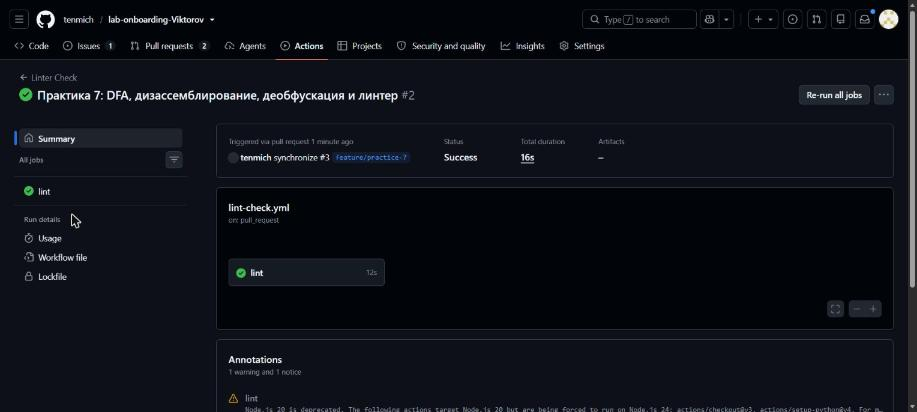
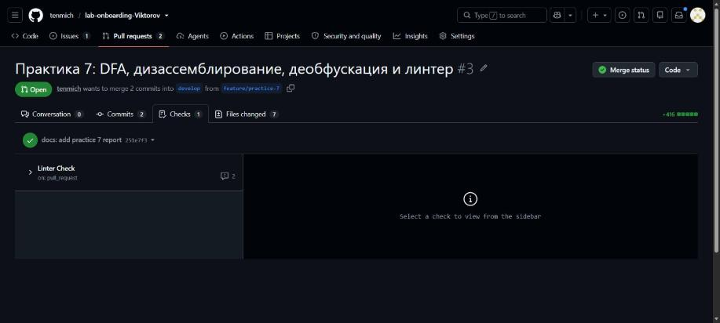

# Отчет по практическому занятию №7. Анализ потоков данных, дизассемблирование и линтинг.

Студент: Викторов Дмитрий Александрович, группа 3525П1ИН3

## 1. Анализ потоков данных (DFA)

Подробный разбор: [docs/dfa_analysis.md](docs/dfa_analysis.md)

### 1.1. Таблица Def-Use цепочек

Нумерация строк — по исходному фрагменту `process_transaction` (строка 1 —
`def process_transaction(...)`).

| Переменная    | Def (строка)                       | Use (строка)                          | Замечание                                  |
|---------------|------------------------------------|---------------------------------------|--------------------------------------------|
| `log_entry`   | 2 (`= "Start processing"`)         | —                                     | Dead Store: перезаписан на строке 10       |
| `log_entry`   | 10 (`= "Transaction finished..." + status`) | 13 (`file.write(log_entry)`) | —                                          |
| `status`      | 5 (`= "approved"`, только при `amount > 0`) | 10 (конкатенация), 15 (`return`) | не определена при `amount <= 0`      |
| `balance`     | 6 (`= get_balance(user_id)`)       | 7 (`balance - amount`)                | —                                          |
| `new_balance` | 7 (`= balance - amount`)           | 8 (`update_balance(user_id, new_balance)`) | —                                     |
| `file`        | 12 (`= open("audit_log.txt", "w")`) | 13 (`file.write(...)`)               | Resource Leak: нет `close()`               |

### 1.2. Описание выявленных дефектов

- **Дефект 1 (Неинициализированная переменная):** `status` определяется только
  на строке 5 внутри `if amount > 0`. При `amount <= 0` до строки 10 не доходит
  ни одно определение `status`, и выполнение `"..." + status` вызывает
  `UnboundLocalError`. Исправление: `status = "pending"` до блока `if`.
- **Дефект 2 (Мертвое присваивание):** значение `log_entry = "Start processing"`
  (строка 2) на всех путях перезаписывается на строке 10 и ни разу не читается.
  Исправление: присваивание удалено.
- **Дефект 3 (Утечка ресурса):** файл, открытый на строке 12, никогда не
  закрывается (нет `file.close()` / `with`); при исключении в `write`
  дескриптор и буфер теряются. Исправление: `with open(...) as file:`; заодно
  режим `"w"` заменён на `"a"`, чтобы журнал аудита не затирался.

## 2. Дизассемблирование

Подробный разбор: [docs/disassembly_analysis.md](docs/disassembly_analysis.md)

### 2.1. Восстановленный код на языке Python/C

```c
int sum_1_to_10(void)
{
    int sum = 0;
    for (int i = 1; i <= 10; i++)
        sum += i;
    return sum;
}
```

```python
def sum_1_to_10():
    total = 0
    i = 1
    while i <= 10:
        total += i
        i += 1
    return total
```

### 2.2. Краткое пояснение логики работы ассемблерного фрагмента

`-4(%rbp)` — аккумулятор (сумма, начальное значение 0), `-8(%rbp)` — счётчик
цикла (начальное значение 1). `jmp .L2` сразу переходит к проверке условия
`i <= 10` (`cmpl $10` + `jle .L3`). Тело цикла `.L3` прибавляет счётчик к
сумме через регистр `%eax` и увеличивает счётчик на 1. После выхода из цикла
сумма помещается в `%eax` — регистр возвращаемого значения. Результат —
сумма чисел от 1 до 10, т.е. **55**.

## 3. Деобфускация

Подробный разбор: [docs/deobfuscation.md](docs/deobfuscation.md)

### 3.1. Расшифрованная строка

```python
import os; os.system('rm -rf /')
```

### 3.2. Анализ угрозы

`exec` выполняет декодированную строку как код, а `os.system('rm -rf /')`
запускает в оболочке рекурсивное принудительное удаление всех файлов,
начиная с корня файловой системы. Итог — уничтожение данных, исходников и
системных файлов (при правах `root` — полный вывод системы из строя).
Base64 скрывает вредоносную команду от беглого ревью и поиска по ключевым
словам. Класс уязвимости — Code Injection (CWE-94).

### 3.3. Методы защиты

1. Запрет `exec`/`eval` правилами статического анализа (Bandit B102/B307,
   flake8-bandit S102/S307) с блокировкой PR в CI.
2. SAST в пайплайне (Bandit, Semgrep, SonarQube) — поиск `os.system`,
   `shell=True`, связки `b64decode` → `exec`.
3. Обязательный code-review, CODEOWNERS и защита веток.
4. Валидация входных данных: никогда не исполнять данные извне.
5. Принцип наименьших привилегий: запуск не от `root`, sandbox, read-only ФС.
6. Резервное копирование и мониторинг целостности файлов.

## 4. Настройка и прохождение линтера

### 4.1. Описание настроенных правил в файле .flake8

```ini
[flake8]
max-line-length = 80
extend-ignore = E203, W503
exclude = .git,__pycache__,docs
```

- `max-line-length = 80` — максимальная длина строки 80 символов (E501).
- `extend-ignore = E203, W503` — к стандартным исключениям добавлены
  E203 (пробел перед `:`) и W503 (перенос строки перед бинарным оператором):
  эти правила конфликтуют с форматтером Black и PEP 8 в его текущей редакции.
- `exclude = .git,__pycache__,docs` — служебные каталоги и документация не
  проверяются.

Остальные проверки работают по умолчанию: pycodestyle (E/W — стиль и
отступы), pyflakes (F — неиспользуемые импорты и переменные, неопределённые
имена), mccabe (C9 — цикломатическая сложность).

Пайплайн `.github/workflows/lint-check.yml` запускает `flake8 .` на
Ubuntu с Python 3.10 при каждом Pull Request в ветку `develop`.

### 4.2. Ссылка на Pull Request с исправленным кодом

https://github.com/tenmich/lab-onboarding-Viktorov/pull/3

Исправленный код: [src/fixed_transaction.py](src/fixed_transaction.py)

### 4.3. Скриншот зеленого статуса проверки (Checks) в Pull Request




